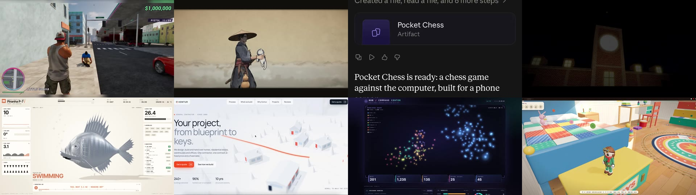
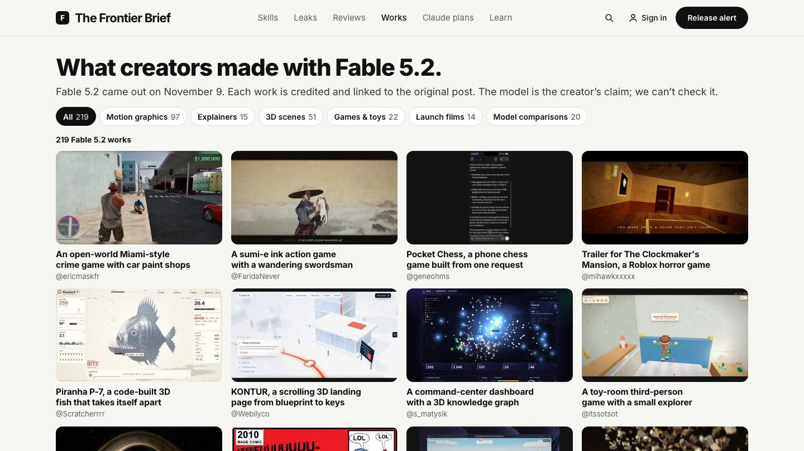

# Awesome Fable 5.2 Videos

[](https://awesome.re) [](https://fable5.app/fable-5-2/works/?utm_source=github&utm_medium=readme&utm_campaign=awesome-fable5-2-videos) [](#prompts-to-copy) [](LICENSE)

<a href="https://fable5.app/fable-5-2/works/?utm_source=github&amp;utm_medium=readme&amp;utm_campaign=awesome-fable5-2-videos"></a>

What people are making with **Claude Fable 5.2**, gathered from X since the model launched on November 9, 2026: motion pieces, 3D scenes, games, explainers and model comparisons. Each entry names its maker and points to the post it came from. When the maker shared the prompt, it is here too, word for word.

**[▶ Watch all 76 on The Frontier Brief](https://fable5.app/fable-5-2/works/?utm_source=github&utm_medium=readme&utm_campaign=awesome-fable5-2-videos)**, newest first, one page per video.

## At a glance

- **76 videos** in 6 categories, newest first
- **8 prompts** published by their makers ([read them](#prompts-to-copy))
- Previews play on this page; every card opens the full video
- Every entry credits its maker and links to the source post on X
- The whole list as JSON: [`data/videos.json`](data/videos.json). One page per video: [`prompts/`](prompts/)

<a href="https://fable5.app/fable-5-2/works/?utm_source=github&amp;utm_medium=readme&amp;utm_campaign=awesome-fable5-2-videos"></a>

## Contents

- [Motion graphics](#motion-graphics) (26)
- [Explainers](#explainers) (5)
- [3D scenes](#3d-scenes) (16)
- [Games](#games) (8)
- [Launch films](#launch-films) (8)
- [Model comparisons](#model-comparisons) (13)
- [Prompts to copy](#prompts-to-copy)
- [Make your own](#make-your-own)
- [Add a video](#add-a-video)
- [Updates](#updates)
- [Credits and removal](#credits-and-removal)

## Motion graphics

<table>
<tr><td width="33%" valign="top"><a href="https://fable5.app/fable-5-2/works/yupi996-694138/?utm_source=github&amp;utm_medium=readme&amp;utm_campaign=awesome-fable5-2-videos"></a><br><sub><b>An AI coding study path laid out as an ancient Chinese scroll</b><br><a href="https://x.com/yupi996">@yupi996</a> · 0:32</sub></td><td width="33%" valign="top"><a href="https://fable5.app/fable-5-2/works/sirbost-712653/?utm_source=github&amp;utm_medium=readme&amp;utm_campaign=awesome-fable5-2-videos"></a><br><sub><b>P(DOOM): a cartoon music video with an AI risk meter</b><br><a href="https://x.com/Sirbost">@Sirbost</a> · 1:05</sub></td><td width="33%" valign="top"><a href="https://fable5.app/fable-5-2/works/guillermocasfer-112423/?utm_source=github&amp;utm_medium=readme&amp;utm_campaign=awesome-fable5-2-videos"></a><br><sub><b>A collage-style AI to AGI animation with a glowing tower</b><br><a href="https://x.com/guillermocasfer">@guillermocasfer</a> · 0:10</sub></td></tr>
<tr><td width="33%" valign="top"><a href="https://fable5.app/fable-5-2/works/tkss2607-824763/?utm_source=github&amp;utm_medium=readme&amp;utm_campaign=awesome-fable5-2-videos"></a><br><sub><b>White Hackers: a Japanese cybersecurity trailer</b><br><a href="https://x.com/Tkss2607">@Tkss2607</a> · 0:30</sub></td><td width="33%" valign="top"><a href="https://fable5.app/fable-5-2/works/tejasthange3-545578/?utm_source=github&amp;utm_medium=readme&amp;utm_campaign=awesome-fable5-2-videos"></a><br><sub><b>The last train of summer: an anime-style rural station from noon to night</b><br><a href="https://x.com/TejasThange3">@TejasThange3</a> · 1:17</sub></td><td width="33%" valign="top"><a href="https://fable5.app/fable-5-2/works/iamtanzil-641645/?utm_source=github&amp;utm_medium=readme&amp;utm_campaign=awesome-fable5-2-videos"></a><br><sub><b>A Dubai architecture studio website built around a 3D model city</b><br><a href="https://x.com/iamtanzil_">@iamtanzil_</a> · 0:31</sub></td></tr>
<tr><td width="33%" valign="top"><a href="https://fable5.app/fable-5-2/works/saypotsan-749050/?utm_source=github&amp;utm_medium=readme&amp;utm_campaign=awesome-fable5-2-videos"></a><br><sub><b>Beyond the Signal: a teal particle film about unbound intelligence</b><br><a href="https://x.com/saypotsan">@saypotsan</a> · 0:25</sub></td><td width="33%" valign="top"><a href="https://fable5.app/fable-5-2/works/sagargiri1707-152264/?utm_source=github&amp;utm_medium=readme&amp;utm_campaign=awesome-fable5-2-videos"></a><br><sub><b>Build it all: a dark launch-style motion piece for Claude Fable 5.2</b><br><a href="https://x.com/SagarGiri1707">@SagarGiri1707</a> · 0:35</sub></td><td width="33%" valign="top"><a href="https://fable5.app/fable-5-2/works/shannnu-18-121516/?utm_source=github&amp;utm_medium=readme&amp;utm_campaign=awesome-fable5-2-videos"></a><br><sub><b>A slow flight into a glowing spiral galaxy</b><br><a href="https://x.com/Shannnu_18">@Shannnu_18</a> · 0:17</sub></td></tr>
<tr><td width="33%" valign="top"><a href="https://fable5.app/fable-5-2/works/freedomaig-763821/?utm_source=github&amp;utm_medium=readme&amp;utm_campaign=awesome-fable5-2-videos"></a><br><sub><b>One dot grows into lines, planes and solids: a Bauhaus-style motion piece</b><br><a href="https://x.com/FreedomAIG">@FreedomAIG</a> · 0:15</sub></td><td width="33%" valign="top"><a href="https://fable5.app/fable-5-2/works/sisyphus-qwq-046541/?utm_source=github&amp;utm_medium=readme&amp;utm_campaign=awesome-fable5-2-videos"></a><br><sub><b>A K-pop style photocard reel with eight illustrated idols</b><br><a href="https://x.com/Sisyphus_QwQ">@Sisyphus_QwQ</a> · 0:30</sub></td><td width="33%" valign="top"><a href="https://fable5.app/fable-5-2/works/himanshutwtxs-900304/?utm_source=github&amp;utm_medium=readme&amp;utm_campaign=awesome-fable5-2-videos"></a><br><sub><b>A one-prompt motion designer showreel: timing, easing, shape and type</b><br><a href="https://x.com/himanshutwtxs">@himanshutwtxs</a> · 0:15 · prompt</sub></td></tr>
<tr><td width="33%" valign="top"><a href="https://fable5.app/fable-5-2/works/deedee-kon45120-814354/?utm_source=github&amp;utm_medium=readme&amp;utm_campaign=awesome-fable5-2-videos"></a><br><sub><b>A pelican with a red scarf rides a bicycle along a seaside road</b><br><a href="https://x.com/deedee_kon45120">@deedee_kon45120</a> · 0:16</sub></td><td width="33%" valign="top"><a href="https://fable5.app/fable-5-2/works/iliazolotukhin-001578/?utm_source=github&amp;utm_medium=readme&amp;utm_campaign=awesome-fable5-2-videos"></a><br><sub><b>A loud Connect Wallet card redesigned into a clean list, again and again</b><br><a href="https://x.com/iliazolotukhin">@iliazolotukhin</a> · 0:17</sub></td><td width="33%" valign="top"><a href="https://fable5.app/fable-5-2/works/0x-zyven-426836/?utm_source=github&amp;utm_medium=readme&amp;utm_campaign=awesome-fable5-2-videos"></a><br><sub><b>A neon night race through a rainy city, finishing in first place</b><br><a href="https://x.com/0x_zyven">@0x_zyven</a> · 0:30</sub></td></tr>
<tr><td width="33%" valign="top"><a href="https://fable5.app/fable-5-2/works/davishaal-195600/?utm_source=github&amp;utm_medium=readme&amp;utm_campaign=awesome-fable5-2-videos"></a><br><sub><b>Sayonara, After School: an anime trailer about a paper plane and a seaside town</b><br><a href="https://x.com/davishaal">@davishaal</a> · 1:06</sub></td><td width="33%" valign="top"><a href="https://fable5.app/fable-5-2/works/takamasa045-262816/?utm_source=github&amp;utm_medium=readme&amp;utm_campaign=awesome-fable5-2-videos"></a><br><sub><b>Just your voice: a Japanese lyric motion video in black, cream and orange</b><br><a href="https://x.com/takamasa045">@takamasa045</a> · 0:53 · prompt</sub></td><td width="33%" valign="top"><a href="https://fable5.app/fable-5-2/works/tankazunori0914-646927/?utm_source=github&amp;utm_medium=readme&amp;utm_campaign=awesome-fable5-2-videos"></a><br><sub><b>From a point to a world: a code-only shader video with a synthesized song</b><br><a href="https://x.com/tankazunori0914">@tankazunori0914</a> · 1:04 · prompt</sub></td></tr>
<tr><td width="33%" valign="top"><a href="https://fable5.app/fable-5-2/works/sadalbert10-760622/?utm_source=github&amp;utm_medium=readme&amp;utm_campaign=awesome-fable5-2-videos"></a><br><sub><b>OVER HELL: a fiery voxel edit, screen-recorded in the Claude app</b><br><a href="https://x.com/SadAlbert10">@SadAlbert10</a> · 1:04</sub></td><td width="33%" valign="top"><a href="https://fable5.app/fable-5-2/works/midnightballoon-928930/?utm_source=github&amp;utm_medium=readme&amp;utm_campaign=awesome-fable5-2-videos"></a><br><sub><b>2027: a vertical particle film about research that never stops</b><br><a href="https://x.com/Midnightballoon">@Midnightballoon</a> · 0:56</sub></td><td width="33%" valign="top"><a href="https://fable5.app/fable-5-2/works/hive-echo-694422/?utm_source=github&amp;utm_medium=readme&amp;utm_campaign=awesome-fable5-2-videos"></a><br><sub><b>A painter with six strokes paints a dark sea and a lighthouse, stage by stage</b><br><a href="https://x.com/hive_echo">@hive_echo</a> · 3:35</sub></td></tr>
<tr><td width="33%" valign="top"><a href="https://fable5.app/fable-5-2/works/niramayo2096-640613/?utm_source=github&amp;utm_medium=readme&amp;utm_campaign=awesome-fable5-2-videos"></a><br><sub><b>Kintsugi: Japanese wave patterns crack and are mended with gold</b><br><a href="https://x.com/niramayo2096">@niramayo2096</a> · 0:20</sub></td><td width="33%" valign="top"><a href="https://fable5.app/fable-5-2/works/s-matysik-213380/?utm_source=github&amp;utm_medium=readme&amp;utm_campaign=awesome-fable5-2-videos"></a><br><sub><b>A command-center dashboard with a 3D knowledge graph</b><br><a href="https://x.com/s_matysik">@s_matysik</a> · 0:33</sub></td><td width="33%" valign="top"><a href="https://fable5.app/fable-5-2/works/elizaveta-ai-125485/?utm_source=github&amp;utm_medium=readme&amp;utm_campaign=awesome-fable5-2-videos"></a><br><sub><b>Deep Dive Switch, a volume slider that goes to the sea floor</b><br><a href="https://x.com/Elizaveta_ai">@Elizaveta_ai</a> · 0:51</sub></td></tr>
<tr><td width="33%" valign="top"><a href="https://fable5.app/fable-5-2/works/aug5thmusic-480107/?utm_source=github&amp;utm_medium=readme&amp;utm_campaign=awesome-fable5-2-videos"></a><br><sub><b>An organ fugue in D minor, written in LilyPond</b><br><a href="https://x.com/aug5thmusic">@aug5thmusic</a> · 2:05 · prompt</sub></td><td width="33%" valign="top"><a href="https://fable5.app/fable-5-2/works/higgsfield-ai-987047/?utm_source=github&amp;utm_medium=readme&amp;utm_campaign=awesome-fable5-2-videos"></a><br><sub><b>A code-built vocal tract singing a lo-fi track</b><br><a href="https://x.com/higgsfield_ai">@higgsfield_ai</a> · 0:50</sub></td></tr>
</table>

## Explainers

<table>
<tr><td width="33%" valign="top"><a href="https://fable5.app/fable-5-2/works/hyuki-993504/?utm_source=github&amp;utm_medium=readme&amp;utm_campaign=awesome-fable5-2-videos"></a><br><sub><b>A Journey Through Symmetry: one triangle and its mirrors tile the plane</b><br><a href="https://x.com/hyuki">@hyuki</a> · 0:30</sub></td><td width="33%" valign="top"><a href="https://fable5.app/fable-5-2/works/holygrail-609690/?utm_source=github&amp;utm_medium=readme&amp;utm_campaign=awesome-fable5-2-videos"></a><br><sub><b>A blog post turned into a fast Japanese slide video about eight months of side projects</b><br><a href="https://x.com/HolyGrail">@HolyGrail</a> · 1:05</sub></td><td width="33%" valign="top"><a href="https://fable5.app/fable-5-2/works/moud47-074864/?utm_source=github&amp;utm_medium=readme&amp;utm_campaign=awesome-fable5-2-videos"></a><br><sub><b>The tale of the twins: an Arabic explainer on Fable 5.2 and Mythos 5.2</b><br><a href="https://x.com/_moud47">@_moud47</a> · 2:45</sub></td></tr>
<tr><td width="33%" valign="top"><a href="https://fable5.app/fable-5-2/works/akira-papa-it-047013/?utm_source=github&amp;utm_medium=readme&amp;utm_campaign=awesome-fable5-2-videos"></a><br><sub><b>A ten-minute Japanese explainer on Fable 5.2, made by Fable 5.2</b><br><a href="https://x.com/akira_papa_IT">@akira_papa_IT</a> · 10:15</sub></td><td width="33%" valign="top"><a href="https://fable5.app/fable-5-2/works/yzr-koba-722932/?utm_source=github&amp;utm_medium=readme&amp;utm_campaign=awesome-fable5-2-videos"></a><br><sub><b>A watercolour explainer on why the sky changes colour</b><br><a href="https://x.com/yzr_koba">@yzr_koba</a> · 0:55</sub></td></tr>
</table>

## 3D scenes

<table>
<tr><td width="33%" valign="top"><a href="https://fable5.app/fable-5-2/works/satya5n21-267380/?utm_source=github&amp;utm_medium=readme&amp;utm_campaign=awesome-fable5-2-videos"></a><br><sub><b>Afterglow: a walk across an alien meadow under a ringed planet</b><br><a href="https://x.com/satya5n21">@satya5n21</a> · 0:51</sub></td><td width="33%" valign="top"><a href="https://fable5.app/fable-5-2/works/shannnu-18-844785/?utm_source=github&amp;utm_medium=readme&amp;utm_campaign=awesome-fable5-2-videos"></a><br><sub><b>Aurora 9: a rocket launch simulation from pad to a 210 km orbit</b><br><a href="https://x.com/Shannnu_18">@Shannnu_18</a> · 2:15</sub></td><td width="33%" valign="top"><a href="https://fable5.app/fable-5-2/works/akionionio-638078/?utm_source=github&amp;utm_medium=readme&amp;utm_campaign=awesome-fable5-2-videos"></a><br><sub><b>A construction site cockpit that grows a 3D city block over two years</b><br><a href="https://x.com/akionionio">@akionionio</a> · 0:45</sub></td></tr>
<tr><td width="33%" valign="top"><a href="https://fable5.app/fable-5-2/works/tsuyatsuyatt-996126/?utm_source=github&amp;utm_medium=readme&amp;utm_campaign=awesome-fable5-2-videos"></a><br><sub><b>Genesis: a 3D showreel from a particle swirl to a glowing planet</b><br><a href="https://x.com/tsuyatsuyatt">@tsuyatsuyatt</a> · 0:46</sub></td><td width="33%" valign="top"><a href="https://fable5.app/fable-5-2/works/rehan-shei-403789/?utm_source=github&amp;utm_medium=readme&amp;utm_campaign=awesome-fable5-2-videos"></a><br><sub><b>A zombie bird character built, rigged and animated in Blender</b><br><a href="https://x.com/rehan_shei">@rehan_shei</a> · 0:32</sub></td><td width="33%" valign="top"><a href="https://fable5.app/fable-5-2/works/krongggggg-956012/?utm_source=github&amp;utm_medium=readme&amp;utm_campaign=awesome-fable5-2-videos"></a><br><sub><b>A 3D destroyer marked H92 cutting through open sea</b><br><a href="https://x.com/Krongggggg">@Krongggggg</a> · 0:05</sub></td></tr>
<tr><td width="33%" valign="top"><a href="https://fable5.app/fable-5-2/works/porisrora-778053/?utm_source=github&amp;utm_medium=readme&amp;utm_campaign=awesome-fable5-2-videos"></a><br><sub><b>A blocky Minecraft-style world of cliffs, cherry trees and floating islands</b><br><a href="https://x.com/PorisRora">@PorisRora</a> · 0:50</sub></td><td width="33%" valign="top"><a href="https://fable5.app/fable-5-2/works/tech2wild-725651/?utm_source=github&amp;utm_medium=readme&amp;utm_campaign=awesome-fable5-2-videos"></a><br><sub><b>Two voxel fighters power up on a white platform beside a temple</b><br><a href="https://x.com/Tech2Wild">@Tech2Wild</a> · 0:20</sub></td><td width="33%" valign="top"><a href="https://fable5.app/fable-5-2/works/jev-chat-426838/?utm_source=github&amp;utm_medium=readme&amp;utm_campaign=awesome-fable5-2-videos"></a><br><sub><b>An acrobat stack on a biplane above the clouds, a 3D short in Chinese</b><br><a href="https://x.com/jev_chat">@jev_chat</a> · 1:03</sub></td></tr>
<tr><td width="33%" valign="top"><a href="https://fable5.app/fable-5-2/works/wshuyi-417720/?utm_source=github&amp;utm_medium=readme&amp;utm_campaign=awesome-fable5-2-videos"></a><br><sub><b>A sabertooth cat hunts a bison on a golden steppe</b><br><a href="https://x.com/wshuyi">@wshuyi</a> · 0:28 · prompt</sub></td><td width="33%" valign="top"><a href="https://fable5.app/fable-5-2/works/bryanpatricca-765272/?utm_source=github&amp;utm_medium=readme&amp;utm_campaign=awesome-fable5-2-videos"></a><br><sub><b>Lamplighter: a little rover finds a sprout in a desert city</b><br><a href="https://x.com/bryanpatricca">@bryanpatricca</a> · 0:27</sub></td><td width="33%" valign="top"><a href="https://fable5.app/fable-5-2/works/scratcherrrr-785332/?utm_source=github&amp;utm_medium=readme&amp;utm_campaign=awesome-fable5-2-videos"></a><br><sub><b>Piranha P-7, a code-built 3D fish that takes itself apart</b><br><a href="https://x.com/Scratcherrrr">@Scratcherrrr</a> · 0:20</sub></td></tr>
<tr><td width="33%" valign="top"><a href="https://fable5.app/fable-5-2/works/webilyco-626667/?utm_source=github&amp;utm_medium=readme&amp;utm_campaign=awesome-fable5-2-videos"></a><br><sub><b>KONTUR, a scrolling 3D landing page from blueprint to keys</b><br><a href="https://x.com/Webilyco">@Webilyco</a> · 0:21</sub></td><td width="33%" valign="top"><a href="https://fable5.app/fable-5-2/works/higgsfield-ai-342326/?utm_source=github&amp;utm_medium=readme&amp;utm_campaign=awesome-fable5-2-videos"></a><br><sub><b>A flat cafe sketch turned into a textured 3D room</b><br><a href="https://x.com/higgsfield_ai">@higgsfield_ai</a> · 0:14</sub></td><td width="33%" valign="top"><a href="https://fable5.app/fable-5-2/works/higgsfield-ai-496421/?utm_source=github&amp;utm_medium=readme&amp;utm_campaign=awesome-fable5-2-videos"></a><br><sub><b>A fly's-eye view of a backyard picnic in Three.js</b><br><a href="https://x.com/higgsfield_ai">@higgsfield_ai</a> · 0:20</sub></td></tr>
<tr><td width="33%" valign="top"><a href="https://fable5.app/fable-5-2/works/luminabench-657696/?utm_source=github&amp;utm_medium=readme&amp;utm_campaign=awesome-fable5-2-videos"></a><br><sub><b>A floating voxel pagoda island through day and night</b><br><a href="https://x.com/LuminaBench">@LuminaBench</a> · 0:47</sub></td></tr>
</table>

## Games

<table>
<tr><td width="33%" valign="top"><a href="https://fable5.app/fable-5-2/works/jarrodwatts-777937/?utm_source=github&amp;utm_medium=readme&amp;utm_campaign=awesome-fable5-2-videos"></a><br><sub><b>A first-person shooter on a grassy island of floating ruins</b><br><a href="https://x.com/jarrodwatts">@jarrodwatts</a> · 0:14</sub></td><td width="33%" valign="top"><a href="https://fable5.app/fable-5-2/works/alexstlouis10-907802/?utm_source=github&amp;utm_medium=readme&amp;utm_campaign=awesome-fable5-2-videos"></a><br><sub><b>Blueline: a 3D ice hockey browser game with penalties and power plays</b><br><a href="https://x.com/AlexStLouis10">@AlexStLouis10</a> · 0:35</sub></td><td width="33%" valign="top"><a href="https://fable5.app/fable-5-2/works/alightinastorm-440210/?utm_source=github&amp;utm_medium=readme&amp;utm_campaign=awesome-fable5-2-videos"></a><br><sub><b>A browser first-person shooter with an armory and a desert town map</b><br><a href="https://x.com/alightinastorm">@alightinastorm</a> · 1:11</sub></td></tr>
<tr><td width="33%" valign="top"><a href="https://fable5.app/fable-5-2/works/ericmaskfr-481026/?utm_source=github&amp;utm_medium=readme&amp;utm_campaign=awesome-fable5-2-videos"></a><br><sub><b>An open-world Miami-style crime game with car paint shops and timed races</b><br><a href="https://x.com/ericmaskfr">@ericmaskfr</a> · 2:15 · prompt</sub></td><td width="33%" valign="top"><a href="https://fable5.app/fable-5-2/works/faridanever-505730/?utm_source=github&amp;utm_medium=readme&amp;utm_campaign=awesome-fable5-2-videos"></a><br><sub><b>A sumi-e ink action game with a wandering swordsman and a white cat</b><br><a href="https://x.com/FaridaNever">@FaridaNever</a> · 2:00</sub></td><td width="33%" valign="top"><a href="https://fable5.app/fable-5-2/works/geneohms-685102/?utm_source=github&amp;utm_medium=readme&amp;utm_campaign=awesome-fable5-2-videos"></a><br><sub><b>Pocket Chess, a phone chess game built from one request</b><br><a href="https://x.com/geneohms">@geneohms</a> · 0:55</sub></td></tr>
<tr><td width="33%" valign="top"><a href="https://fable5.app/fable-5-2/works/mihawkxxxxx-699749/?utm_source=github&amp;utm_medium=readme&amp;utm_campaign=awesome-fable5-2-videos"></a><br><sub><b>Trailer for The Clockmaker's Mansion, a Roblox horror game</b><br><a href="https://x.com/mihawkxxxxx">@mihawkxxxxx</a> · 0:55</sub></td><td width="33%" valign="top"><a href="https://fable5.app/fable-5-2/works/itssotsot-491720/?utm_source=github&amp;utm_medium=readme&amp;utm_campaign=awesome-fable5-2-videos"></a><br><sub><b>A toy-room third-person game with a small explorer collecting items</b><br><a href="https://x.com/itssotsot">@itssotsot</a> · 1:35 · prompt</sub></td></tr>
</table>

## Launch films

<table>
<tr><td width="33%" valign="top"><a href="https://fable5.app/fable-5-2/works/augustobuilds-283723/?utm_source=github&amp;utm_medium=readme&amp;utm_campaign=awesome-fable5-2-videos"></a><br><sub><b>Hero in Motion: a kinetic-type film for a video hero that waits for Play</b><br><a href="https://x.com/AugustoBuilds">@AugustoBuilds</a> · 0:16</sub></td><td width="33%" valign="top"><a href="https://fable5.app/fable-5-2/works/roketssi-665272/?utm_source=github&amp;utm_medium=readme&amp;utm_campaign=awesome-fable5-2-videos"></a><br><sub><b>AirTranslate: a vertical launch film for a live-caption Mac app</b><br><a href="https://x.com/RoketsSI">@RoketsSI</a> · 0:27</sub></td><td width="33%" valign="top"><a href="https://fable5.app/fable-5-2/works/ma-kanteishi-152239/?utm_source=github&amp;utm_medium=readme&amp;utm_campaign=awesome-fable5-2-videos"></a><br><sub><b>A Japanese promo for an AI-assisted real estate appraiser</b><br><a href="https://x.com/ma_kanteishi">@ma_kanteishi</a> · 0:44</sub></td></tr>
<tr><td width="33%" valign="top"><a href="https://fable5.app/fable-5-2/works/lovekeshanand07-613199/?utm_source=github&amp;utm_medium=readme&amp;utm_campaign=awesome-fable5-2-videos"></a><br><sub><b>whyred: a glitchy launch film for a CI log diagnosis tool</b><br><a href="https://x.com/LovekeshAnand07">@LovekeshAnand07</a> · 0:30</sub></td><td width="33%" valign="top"><a href="https://fable5.app/fable-5-2/works/czzzzzzj-682817/?utm_source=github&amp;utm_medium=readme&amp;utm_campaign=awesome-fable5-2-videos"></a><br><sub><b>A keynote-style promo film for a Chinese AI knowledge site</b><br><a href="https://x.com/czzzzzzJ_">@czzzzzzJ_</a> · 4:58 · prompt</sub></td><td width="33%" valign="top"><a href="https://fable5.app/fable-5-2/works/chhddavid-382119/?utm_source=github&amp;utm_medium=readme&amp;utm_campaign=awesome-fable5-2-videos"></a><br><sub><b>Meet your AI employees: a launch film for Shipper</b><br><a href="https://x.com/chhddavid">@chhddavid</a> · 0:50</sub></td></tr>
<tr><td width="33%" valign="top"><a href="https://fable5.app/fable-5-2/works/j-h-h-3-310895/?utm_source=github&amp;utm_medium=readme&amp;utm_campaign=awesome-fable5-2-videos"></a><br><sub><b>Assembly: a one-prompt film of a tiny forest world built on a desk</b><br><a href="https://x.com/j_h_h_3">@j_h_h_3</a> · 1:00</sub></td><td width="33%" valign="top"><a href="https://fable5.app/fable-5-2/works/higgsfield-ai-614926/?utm_source=github&amp;utm_medium=readme&amp;utm_campaign=awesome-fable5-2-videos"></a><br><sub><b>TORQK: a launch film for a robot joint that Fable invented and built in Blender</b><br><a href="https://x.com/higgsfield_ai">@higgsfield_ai</a> · 0:30</sub></td></tr>
</table>

## Model comparisons

<table>
<tr><td width="33%" valign="top"><a href="https://fable5.app/fable-5-2/works/motion-so-361891/?utm_source=github&amp;utm_medium=readme&amp;utm_campaign=awesome-fable5-2-videos"></a><br><sub><b>Opus 5.5 vs Fable 5.2 on the same Motion prompt: a castle and a privilege-escalation story</b><br><a href="https://x.com/motion_so">@motion_so</a> · 0:30</sub></td><td width="33%" valign="top"><a href="https://fable5.app/fable-5-2/works/dubibubiii-425413/?utm_source=github&amp;utm_medium=readme&amp;utm_campaign=awesome-fable5-2-videos"></a><br><sub><b>Fable 5.2 vs Opus 5.5: a one-minute cartoon on the evolution of the Claude mascot</b><br><a href="https://x.com/Dubibubiii">@Dubibubiii</a> · 1:29</sub></td><td width="33%" valign="top"><a href="https://fable5.app/fable-5-2/works/kernelchai-628006/?utm_source=github&amp;utm_medium=readme&amp;utm_campaign=awesome-fable5-2-videos"></a><br><sub><b>Opus 5.5 vs Fable 5.2 building the same chai stall game</b><br><a href="https://x.com/KernelChai">@KernelChai</a> · 0:36</sub></td></tr>
<tr><td width="33%" valign="top"><a href="https://fable5.app/fable-5-2/works/makaneko-ai-938583/?utm_source=github&amp;utm_medium=readme&amp;utm_campaign=awesome-fable5-2-videos"></a><br><sub><b>Fable 5.2 vs Opus 5.5 building the same Japanese intro page for Fable 5.2</b><br><a href="https://x.com/makaneko_AI">@makaneko_AI</a> · 0:26</sub></td><td width="33%" valign="top"><a href="https://fable5.app/fable-5-2/works/leohuanfang-934713/?utm_source=github&amp;utm_medium=readme&amp;utm_campaign=awesome-fable5-2-videos"></a><br><sub><b>The viral stickman fight prompt rerun on Fable 5.2 and Opus 5.5</b><br><a href="https://x.com/leohuanfang">@leohuanfang</a> · 0:13</sub></td><td width="33%" valign="top"><a href="https://fable5.app/fable-5-2/works/leohuanfang-137874/?utm_source=github&amp;utm_medium=readme&amp;utm_campaign=awesome-fable5-2-videos"></a><br><sub><b>The viral sailing ship prompt rerun on Fable 5.2 and Opus 5.5</b><br><a href="https://x.com/leohuanfang">@leohuanfang</a> · 0:14</sub></td></tr>
<tr><td width="33%" valign="top"><a href="https://fable5.app/fable-5-2/works/leohuanfang-029529/?utm_source=github&amp;utm_medium=readme&amp;utm_campaign=awesome-fable5-2-videos"></a><br><sub><b>The viral robot film prompt rerun on Fable 5.2 and Opus 5.5</b><br><a href="https://x.com/leohuanfang">@leohuanfang</a> · 0:14</sub></td><td width="33%" valign="top"><a href="https://fable5.app/fable-5-2/works/mrtacticalx-996053/?utm_source=github&amp;utm_medium=readme&amp;utm_campaign=awesome-fable5-2-videos"></a><br><sub><b>Fable 5.2 vs Opus 5.5: a floating windmill island in Minecraft style</b><br><a href="https://x.com/MrTacticalX">@MrTacticalX</a> · 1:09</sub></td><td width="33%" valign="top"><a href="https://fable5.app/fable-5-2/works/genel-ai-823227/?utm_source=github&amp;utm_medium=readme&amp;utm_campaign=awesome-fable5-2-videos"></a><br><sub><b>Opus 5.5 vs Fable 5.2 designing the same chicken lunch truck website</b><br><a href="https://x.com/genel_ai">@genel_ai</a> · 0:15</sub></td></tr>
<tr><td width="33%" valign="top"><a href="https://fable5.app/fable-5-2/works/buildwithavis-868024/?utm_source=github&amp;utm_medium=readme&amp;utm_campaign=awesome-fable5-2-videos"></a><br><sub><b>Fable 5.2 vs GPT 6 Astra: the same Tet floating flower market</b><br><a href="https://x.com/buildwithavis">@buildwithavis</a> · 0:15</sub></td><td width="33%" valign="top"><a href="https://fable5.app/fable-5-2/works/shannnu-18-396903/?utm_source=github&amp;utm_medium=readme&amp;utm_campaign=awesome-fable5-2-videos"></a><br><sub><b>Fable 5 in July vs Fable 5.2 in November: an Earth viewer side by side</b><br><a href="https://x.com/Shannnu_18">@Shannnu_18</a> · 1:00</sub></td><td width="33%" valign="top"><a href="https://fable5.app/fable-5-2/works/envoldev-245180/?utm_source=github&amp;utm_medium=readme&amp;utm_campaign=awesome-fable5-2-videos"></a><br><sub><b>Fable 5.2 vs Opus 5.5: a ship among ice arches</b><br><a href="https://x.com/EnvolDev">@EnvolDev</a> · 0:25</sub></td></tr>
<tr><td width="33%" valign="top"><a href="https://fable5.app/fable-5-2/works/whydeso-575757/?utm_source=github&amp;utm_medium=readme&amp;utm_campaign=awesome-fable5-2-videos"></a><br><sub><b>Gemini 4 Argon vs Fable 5.2 making a top-down crime game</b><br><a href="https://x.com/whydeso">@whydeso</a> · 0:28</sub></td></tr>
</table>

## Prompts to copy

The makers of these videos posted the words they gave Fable 5.2.

### A keynote-style promo film for a Chinese AI knowledge site

By [@czzzzzzJ_](https://x.com/czzzzzzJ_) · [▶ Watch](https://media.fable5.app/fable-5-2/czzzzzzj-682817/video.2a24cadc6b.mp4) · [Source](https://x.com/czzzzzzJ_/status/2120023093464682817)

```text
你现在在我的知识站项目目录下，完整地调研我知识站上所有的业务、提供的内容，以及我的商业模式。使用 opuscar这个库帮我生成我的知识站宣传视频，整体风格我希望是像苹果的发布会那种风格质感。素材可以自行搜索和获取截屏。关于我不了解的内容，DOC 文件夹下有我的个人介绍。在整个宣传片制作前，你有一次向我提问的机会，收集我的想法，然后我要求你直接成片。
```

### A one-prompt motion designer showreel: timing, easing, shape and type

By [@himanshutwtxs](https://x.com/himanshutwtxs) · [▶ Watch](https://media.fable5.app/fable-5-2/himanshutwtxs-900304/video.6282817cbf.mp4) · [Source](https://x.com/himanshutwtxs/status/2120017106804900304)

```text
make a dynamic 15-second motion graphics video that shows what an incredible motion designer you are, like it's your showreel for a résumé. go all out
```

### A sabertooth cat hunts a bison on a golden steppe

By [@wshuyi](https://x.com/wshuyi) · [▶ Watch](https://media.fable5.app/fable-5-2/wshuyi-417720/video.9c0ee1542b.mp4) · [Source](https://x.com/wshuyi/status/2120014892040417720)

```text
不使用任何技能，做一段纯编程形成的动画视频：剑齿虎的捕猎。不用配音，你自己编程生成音效，时长控制在 30 秒以内
```

### Just your voice: a Japanese lyric motion video in black, cream and orange

By [@takamasa045](https://x.com/takamasa045) · [▶ Watch](https://media.fable5.app/fable-5-2/takamasa045-262816/video.e046e6784c.mp4) · [Source](https://x.com/takamasa045/status/2120014216753262816)

```text
自分がどれほど優れたモーションデザイナーか、ポートフォリオ作品のつもりで披露せよ。ツールも技術も自由。大胆なアートディレクションと力強いモーションで、1秒も無駄にするな。まずは1分くらい
```

### From a point to a world: a code-only shader video with a synthesized song

By [@tankazunori0914](https://x.com/tankazunori0914) · [▶ Watch](https://media.fable5.app/fable-5-2/tankazunori0914-646927/video.7b3a50a855.mp4) · [Source](https://x.com/tankazunori0914/status/2120012834461646927)

```text
Fable 5.2の実力を見せつける動画を作成して。
条件：素材ゼロ、コードだけで作る。hyperframesスキルの「暗い地・光・粒子は避ける」「音楽をコードで書かない」は今回は外してよい。
```

### An open-world Miami-style crime game with car paint shops and timed races

By [@ericmaskfr](https://x.com/ericmaskfr) · [▶ Watch](https://media.fable5.app/fable-5-2/ericmaskfr-481026/video.7497407589.mp4) · [Source](https://x.com/ericmaskfr/status/2119910195325481026)

```text
you're a senior game dev. build a third-person open-world crime game in a sunny 80s miami-style city. make the loop tight: walk, fight, steal a car, get chased, earn money, spend it. every system feeds the next: crimes bring heat, heat brings cops, missions pay, money unlocks the garage. cars need weight: gears, skids, real crashes. the city has to feel alive with traffic, people and day into night. no audio files, generate every sound in code. after each system, play it yourself, screenshot it and fix what looks wrong. don't stop until a stranger could play for 10 minutes without hitting a bug
```

### A toy-room third-person game with a small explorer collecting items

By [@itssotsot](https://x.com/itssotsot) · [▶ Watch](https://media.fable5.app/fable-5-2/itssotsot-491720/video.c4a1f13dbd.mp4) · [Source](https://x.com/itssotsot/status/2119909017216491720)

```text
I want you to create a three.js third-person game where I am Woody from Toy Story inside the house, and I can walk and jump through furniture and objects and find the other characters. Make sure to capture the aesthetic and style of the movie.
```

### An organ fugue in D minor, written in LilyPond

By [@aug5thmusic](https://x.com/aug5thmusic) · [▶ Watch](https://media.fable5.app/fable-5-2/aug5thmusic-480107/video.cebaaa83a9.mp4) · [Source](https://x.com/aug5thmusic/status/2119907891419480107)

```text
In LilyPond (version 2.24), write a complete fugue for organ in the style of Bach.
```

## Make your own

1. Open Claude Fable 5.2 in Claude or Claude Code (version 2.1.321 or later). It has to be picked in the model menu; the default does not change by itself.
2. Pick a prompt above, or describe one scene, its length and how it should move.
3. Ask for a single HTML file or a small HTML project, and ask it to record the result to MP4.

Claude Fable availability and limits by plan: [The Frontier Brief](https://fable5.app/fable-5-2/).

## Add a video

Made something with Fable 5.2, or found a video that belongs here? [Open an issue](https://github.com/liang8989/awesome-fable5-2-videos/issues/new?template=add-a-video.md) with the link to the post. The maker needs to say which model they used.

## Updates

- **2026-11-10**: 76 added, 76 in total

## Credits and removal

Each video belongs to the person who made it and the credit on its card points to them. The code and text of this list are under the [MIT license](LICENSE), which does not cover the videos or the quoted posts.

If a video here is yours and you want it changed or removed, [open an issue](https://github.com/liang8989/awesome-fable5-2-videos/issues/new) or write to support@fable5.app and it will be taken down.

Not affiliated with Anthropic. Claude and Fable are Anthropic's trademarks. Maintained by [The Frontier Brief](https://fable5.app/fable-5-2/works/?utm_source=github&utm_medium=readme&utm_campaign=awesome-fable5-2-videos).
